<div align="center">

# File Manager

See, sort and clean up the files uploaded to your Roam graph.

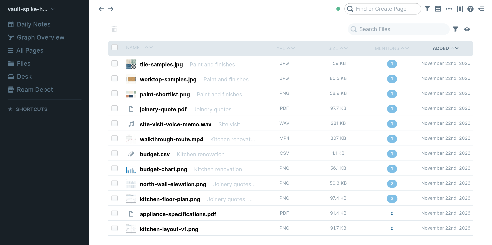

</div>

Every picture, PDF, recording and video you drop into Roam is stored with your graph, and Roam has no
place to look at them all. File Manager adds one: **Files**, in the left sidebar under **All Pages**. It
lists every file in your blocks in a table that works like All Pages, shows which files no block
mentions any more, and lets you delete the ones you don't want to keep.

Nothing in your graph is changed, and nothing is deleted unless you confirm it.

## Getting started

1. Install **File Manager** from Roam Depot.
2. Click **Files** in the left sidebar, under **All Pages**.

The first time the list opens it fetches each file's size, upload date and name from Roam's file
storage. On a graph with many files that takes a few seconds (about 75 files a second). A progress bar
in the middle of the list shows how far it has got, and the list waits, dimmed, until every size is in.

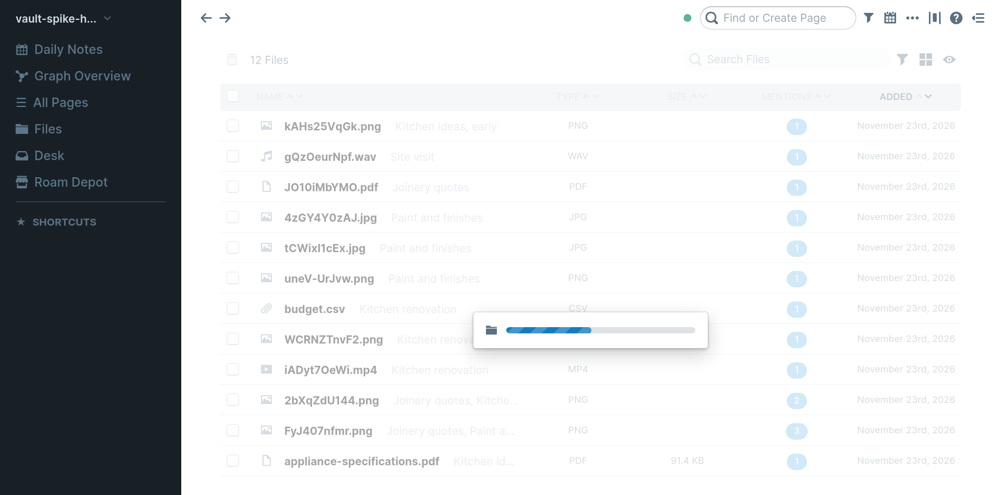

After that it's all kept on your device, and the list opens at once. The same bar shows for a moment when
a sort takes a while, which only happens with tens of thousands of files.

## The list

| Column | What it shows |
| --- | --- |
| **Name** | The name the file was uploaded with, with its picture, and next to it in grey the page (or pages) it's on. Click the name to open the file. |
| **Type** | PNG, PDF, MP4 and so on. |
| **Size** | How much of your storage the file takes. |
| **Mentions** | How many blocks the file is in. Click the count to [see those blocks](#mentions). |
| **Added** | The day the file was uploaded. |

The eye above the list hides the columns you don't need.

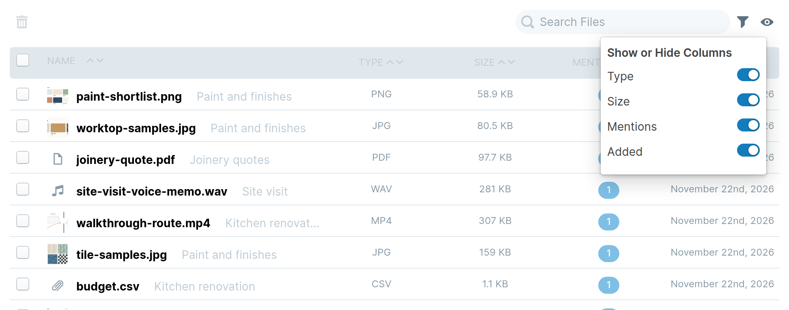

### Sort

Click a column's heading or its arrows to sort by it. The list starts with the newest files first. Here
it's sorted by **Size**, largest first, which is the quick way to see what takes up your storage.

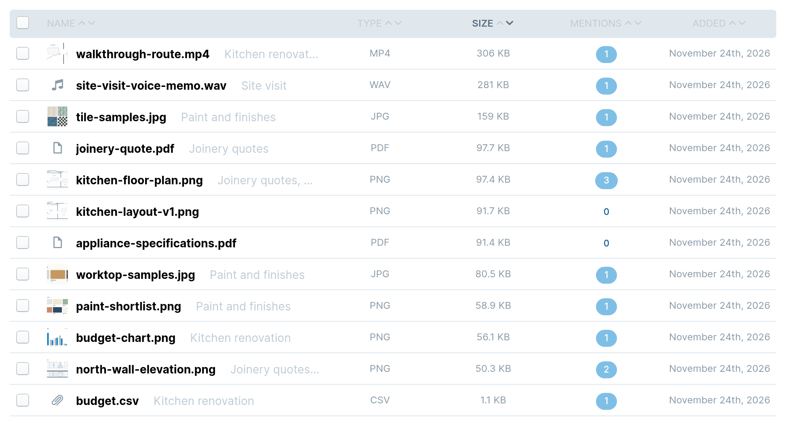

### Search

**Search Files** looks in file names, in types (type `pdf`) and in the names of the pages files are on.
Here `paint` finds the files on the page **Paint and finishes**.

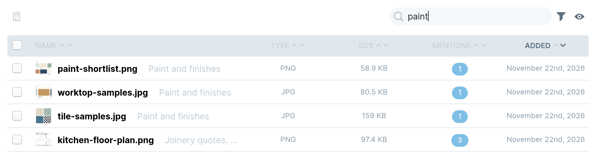

### Filter, and files nothing uses

The filter narrows the list to **Images**, **PDFs**, **Audio**, **Video** or **Other files**. Its last
switch, **Unused**, lists the files that no block mentions any more: they show **0** under Mentions.

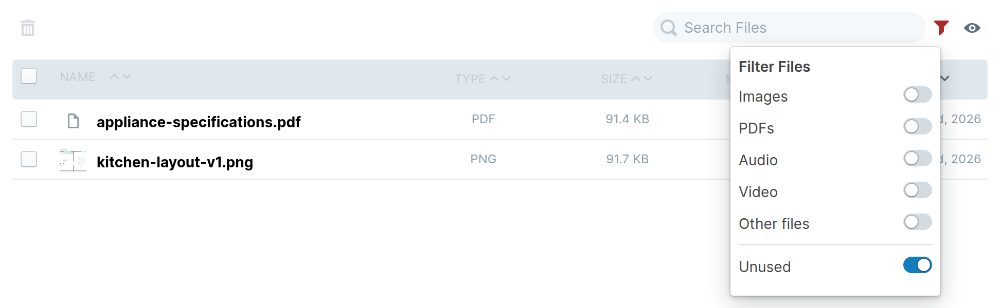

When you delete a block that holds an upload, Roam keeps the file in its storage. Those are the files
**Unused** finds.

## Previews

Hover over a picture to see it larger.

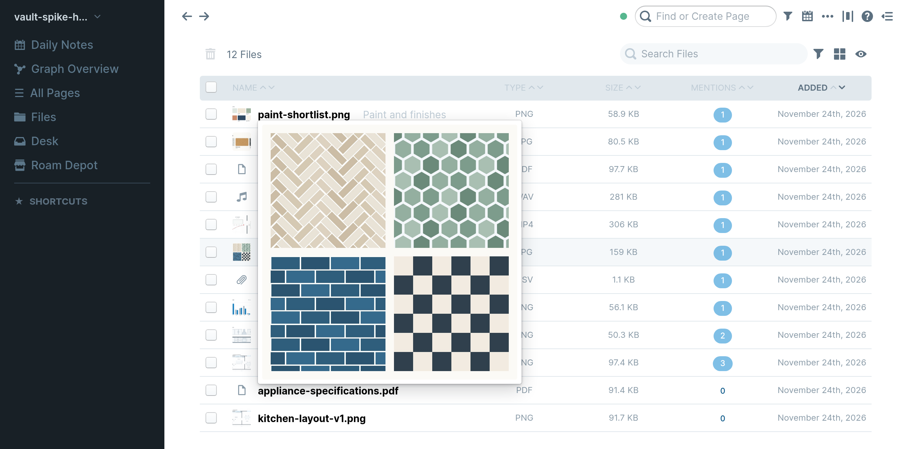

Hover over a video to play it. It starts without sound, and its controls turn the sound on.

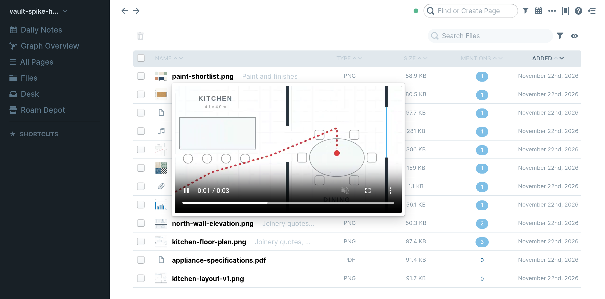

A video's small picture in the list is a frame of the video itself.

## Mentions

**Mentions** counts the blocks a file is in. Click the count to open those blocks in the right sidebar,
the way All Pages opens a page's mentions. The list stays where it is.

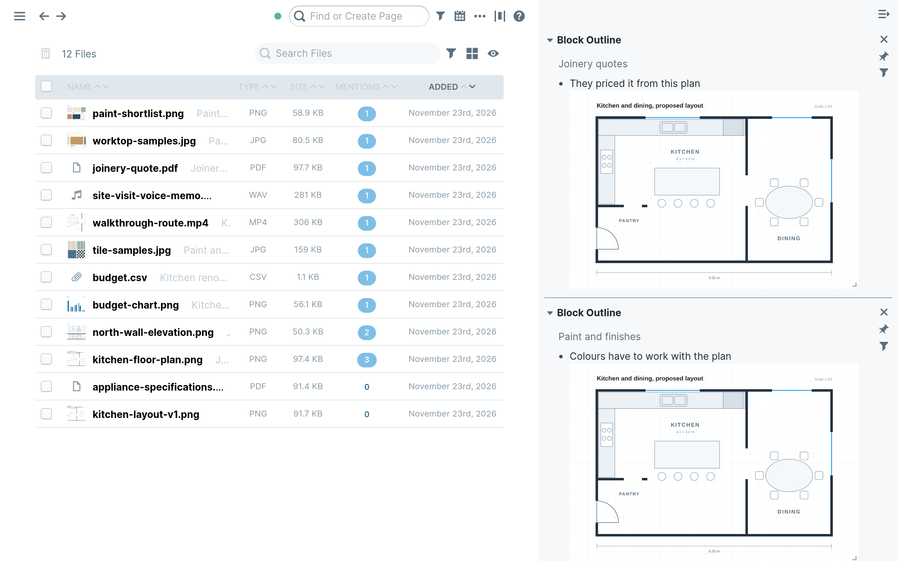

## Deleting files

Tick one or more files and press the trash. Roam asks you to confirm, and shows each file with its
picture (for a video, a frame of it), its type and size, and its mentions.

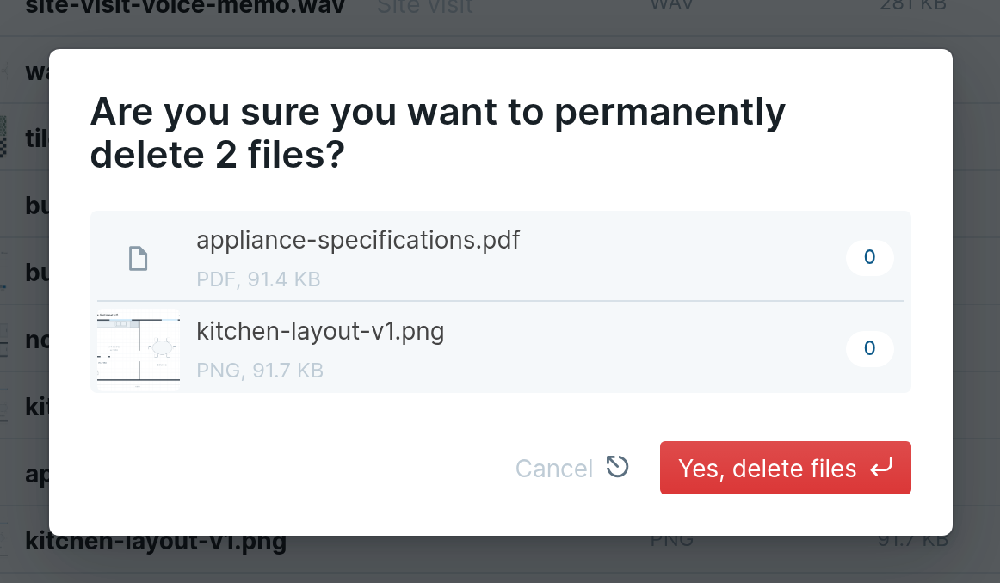

**Deleting is permanent.** The file is removed from Roam's storage and can't be brought back.

| | What deleting does |
| --- | --- |
| **A file with 0 mentions** | It's in none of your blocks, so nothing in your graph changes. |
| **A file that blocks still mention** | The file goes, and those blocks are left as they are: they'll show a broken image or a dead link. The confirmation warns you first, and you have to click the red button. **Enter** doesn't confirm. |

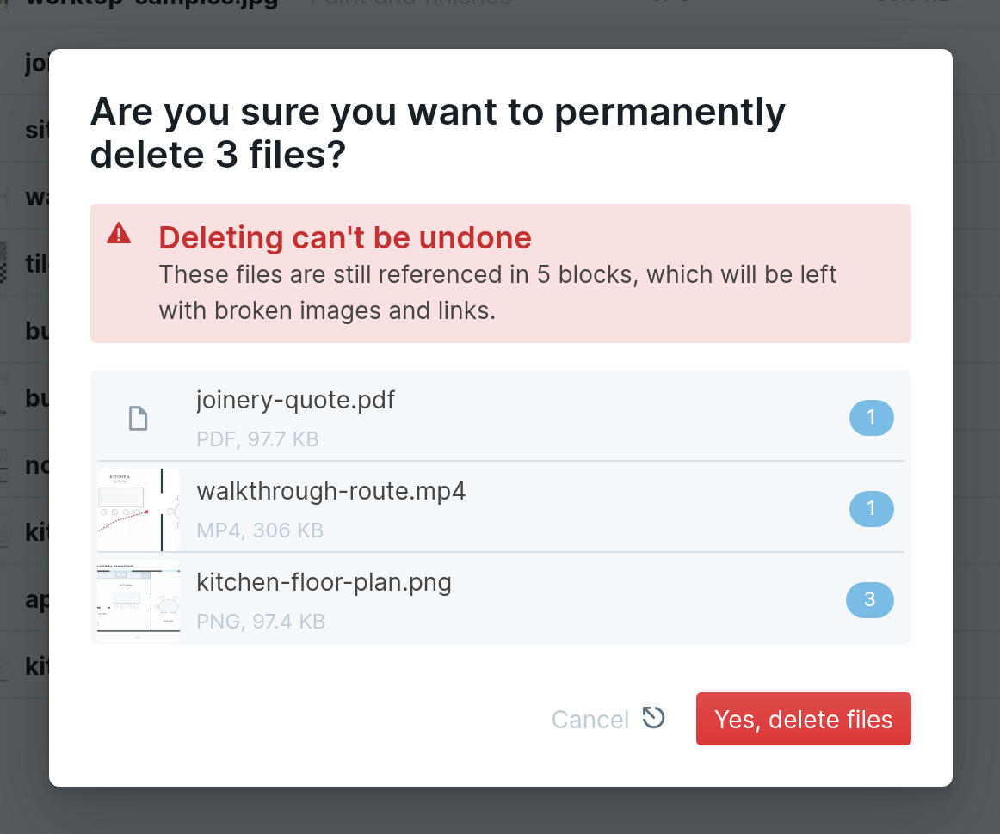

In the confirmation you can hover over a picture or video to see or play it, and click a mentions count to
look at the blocks first: the confirmation closes, nothing is deleted and your ticks stay.

## Good to know

<details>
<summary><b>Which unused files it can find</b></summary>

Roam doesn't let an extension list a graph's stored files. File Manager finds files by reading your
blocks, when Roam starts and every ten minutes after that, and remembers on your device every file it has
seen there. A file shows 0 mentions when it was seen in a block and no block holds it any more.

So a file that lost its block before File Manager was installed doesn't appear, and neither does one
that was uploaded and removed again within a few minutes.
</details>

<details>
<summary><b>Files from other graphs</b></summary>

A file pasted in from another graph is listed, but it's stored with that graph. It can't be ticked or
deleted from here.
</details>

<details>
<summary><b>Videos without a picture</b></summary>

A video's picture is made the first time the video is listed, and kept on your device. It needs your
computer to be able to play the video: a video in a format it can't play (for example an iPhone's HEVC
recording on a computer without HEVC support) keeps the video icon.
</details>

<details>
<summary><b>What's kept, and where</b></summary>

File sizes, upload dates, video pictures and the list of files File Manager has seen are kept on your
device, so each computer you use builds its own. Nothing is written to your graph, and nothing is sent
anywhere except to Roam's own file storage, to read a file's size and date and to delete the files you
confirm.
</details>

## Development

```
npm install
npm test             # unit tests
npm run build        # writes extension.js
node test/help-graph.mjs   # the build in Roam's public help graph, headless (needs Playwright)
```

To load a build in Roam: Settings > Roam Depot > enable developer mode, then load this folder.
`test/real-roam/run.mjs` runs the build in Roam's desktop app against a hosted test graph; see
`.github/workflows/real-roam.yml`.

The pictures on this page are taken in Roam's desktop app by `test/real-roam/screenshots.mjs`, on files
it draws and uploads itself (`test/real-roam/demo-files.mjs`). Run the **Screenshots** workflow on the
release branch before every release: it commits new pictures to `docs/images` and points this page at
them.
